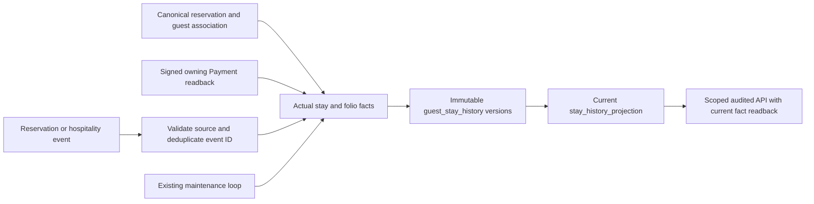

# Business guest CRM boundaries and factual stay history

Business Operations owns its tenant-local guest profiles, property scopes,
consents, corporate agreements and business stay history. Marketplace remains
the authority for its customer accounts. A phone number or email match never
establishes identity. Signed, current source assertions and independently
reviewed typed links establish external associations. Contact and sensitive
preference data use the existing protected store, distinct AAD and purpose checks.

The current stay-history implementation reloads this service's canonical
reservations, accepted room products, actual stays/assignments, immutable folio
postings and signed Payment readback projections. It does not read another
service's database. Broker payloads are hints: a claimed completion, amount or
guest reference cannot override those owned records. Producer, aggregate type,
tenant and source version are checked before processing. Derived events clear
untrusted actor delegation while preserving trace/correlation context.

`stay_history_projection` is the current index; `guest_stay_history` retains each
changed source snapshot. They share tenant/property references and unique
projection/version identities. A deferred database constraint requires matching
immutable evidence for every current projection write. Each snapshot records
reservation, stay and folio versions plus exact Payment projection references.
When an event triggered the write, its ID, type, aggregate identity and version
are retained. Replaying old or duplicate events refreshes current facts without
duplicating versions or regressing a later source state.

An in-house or unobserved departure has unknown actual nights. Once actual
departures are recorded, unique occupied civil dates are counted in the property
timezone; overlapping rooms do not multiply a guest's nights, and DST hours are
not divided by 24. A same-day visit can have zero overnight nights. Promised
reservation dates never establish actual occupancy. Accepted room-type references
come from the immutable accepted pool identity; unsupported historical room-type
attribution remains absent.

A completed reservation with actual departed guest stays is a physical fact.
`settled_obligation_minor` is available only when its closed source folios have
exact usable, fresh signed Payment settlement backing. It represents covered
folio obligations, not a Payment ledger, cash balance, net revenue or profit.
Expiry, reversal or remedy restrictions remove monetary eligibility while
preserving physical history. The public history API reloads current facts under
the tenant fence and reports projection lag; cached monetary values cannot
extend provider authority. Read access requires guest, reservation and folio
capabilities in the validated property, is audited and uses `Cache-Control:
no-store`.

The existing JetStream consumer, transactional outbox, processed-event registry
and maintenance scheduler provide delivery and recovery. No second scheduler or
identity framework is introduced. Due cursors provide fair bounded reconciliation
after restart or event retention. A failed source rolls back to a savepoint while
the organisation lock remains held; its retry status commits without partial
guest snapshots or starving unrelated guests. Twelve failures quarantine the
source from periodic retries. An authenticated MFA rebuild, or a valid new source
event followed by successful canonical readback, can clear repaired sources.
Pending and source-review counts remain visible through the scoped history API.

Local tests use disposable PostgreSQL and a real disk-backed JetStream server,
including outage/restart, duplicate events, forged claims, financial expiry,
concurrent reconciliation and a deliberately limited test database role. No
provider test double establishes live Payment or staging deployment certification.
Full privacy retention/export, identity merge, loyalty, recovery/remedies,
consent-aware notification delivery and complete CRM reporting remain current
implementation work until their owning commands and tests are delivered.
