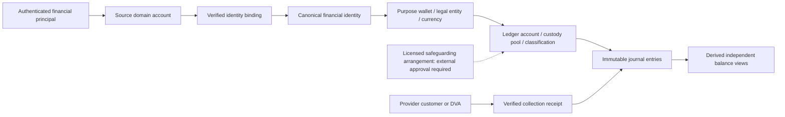

# Sections 11–14 financial architecture and operations

Authority is the user's Sections 11–14 implementation prompt. The master blueprint is reference material. Earlier section closures remain historical evidence; their older stop instructions and pre-certification provider statuses are not the current verdict. This extension uses the existing Financial Core and does not deploy or enable live money operations.

## Ownership and account purposes

Financial identity is the canonical legal-party reference and verified cross-domain bindings. It is not an authenticated session, staff role, provider customer, DVA or bank account. Verification-service alone may attach a new domain account to an existing identity using evidence. Already different identities cannot be silently merged.

Wallet uniqueness is `(identity, source domain/account-purpose scope, purpose, legal entity, currency)`. The source scope preserves the existing authority boundary: another product cannot acquire an earnings wallet by asserting a role. CUSTOMER/TENANT use PERSONAL; approved beneficiary roles use EARNINGS. OWNER/CO_OWNER share one EARNINGS wallet within the same source scope. A verified linked person can have a separate personal purpose and earnings purposes without becoming two people. A purpose is independent of a role; `wallet_roles` stores authenticated role grants. Currency/entity separation is mandatory. Cross-product earnings access would require an explicitly authorized purpose/access contract, rather than automatically sharing ownership across services.

Supported registrations: marketplace CUSTOMER, TENANT, AGENT, BROKER; Individual Owner OWNER/CO_OWNER; Business CORPORATE_OWNER/DEVELOPER/HOSPITALITY; Manager MANAGER/MANAGEMENT_COMPANY; Artisan ARTISAN/SERVICE_COMPANY; Professional PROFESSIONAL/PROFESSIONAL_FIRM. Organization roles require ORGANIZATION; person roles require PERSON, with the pre-existing organization CUSTOMER contract retained. Vendors can use an approved service-company principal. New domains/roles need reviewed allowlists/contracts. Admin, service identities and staff roles are excluded from customer provisioning.

`EnsureWallet` locks the source account and identity, checks legal kind, activation and delegated account, then uses the purpose uniqueness constraint. It creates identity/binding/wallet metadata and role/audit/outbox facts, never a ledger opening balance. Structural ACTIVE does not assert KYC/KYB: `/profile` reports PENDING/VERIFIED/EXPIRED/REVOKED independently, with canonical party, purpose, creation time, roles and account/pool references. Existing seven-field Wallet/event DTOs remain compatible.

Migration 00007 picks the earliest historical wallet for each existing purpose scope. Other historical role wallets receive `LEGACY_RETAINED:<wallet-id>` purposes. No wallets, IDs, entries, balances, original roles or journals are merged. They remain owned and readable. New role grants attach to the canonical purpose wallet. Owner's wallet read selects the explicit EARNINGS profile and includes retained wallet references, including restricted wallets. Tests upgrade a real database at migration 6 containing two funded historical role wallets and verify their unchanged balances and journal count.

Financial Core alone accesses payment_db. Owner alone accesses owner_db. Business services request signed operations and retain their agreements, property authority, obligations and accepted commercial terms. They cannot post journals or set balances. No new cross-service SQL access was introduced.

## Balances, money and DVA

`account_balances` remains the numeric aggregate view over immutable entries. Public buckets are PAYMENT_PENDING, PENDING_EARNINGS, PROTECTED, AVAILABLE, FROZEN, WITHDRAWAL_PENDING and REFUND_PENDING. DEPOSIT is presented as PROTECTED once; it is not also free income. Account dimensions retain beneficiary/obligation separation within a wallet and pool. History and availability readers remain ownership guarded. AVAILABLE alone is eligible for ordinary spending; withdrawable-now requires the existing additional payout checks. CUSTOMER and TENANT cash-out remains false. A frozen wallet stays readable.

Amount values are integer minor units. Aggregate balances are numeric strings to avoid overflow. NGN 30,000/10,000/80,000 are 3,000,000/1,000,000/8,000,000 minor units. A 100,000-minor-unit internal transfer yields 2,900,000/1,100,000/8,000,000, preserving 12,000,000 total. The third user and ledger cash do not change. Tests reject a 3,500,000 debit by A despite B/C's money and ample pool cash.

Verified collection creates a receipt and receivable/pending liability atomically. A redirect or checkout cannot create availability. Availability requires matched funding, independently evidenced cash/coverage and the existing policy checks. Test cash and policies in integration databases are synthetic, isolated and explicitly labelled; merchant balance or empty settlement responses are not safeguarding proof.

DVAs are collection identifiers linked to provider customer, source wallet, merchant, mode, identity verification, consent/version/expiry and masked bank information. A DVA is not a separate ledger, custody approval or authorization to debit a bank. Paystack's current merchant DVA restriction is retained. Direct Titan integration is not introduced as a bypass. Adapter interfaces support future rails while external configuration/approval remains mandatory.

## Controlled internal transfer

`REQUESTED -> POSTED` is the only economic state transition. Request records immutable parties, source actor/service, intent fingerprint, approved test policy, purpose, consent and risk decision. It moves and reserves no money. Confirm revalidates policy dates, scope, provider mode/operational eligibility, current verification, both wallet/identity states, source ownership, same entity/currency/pool and current amount/daily limits. The receiver cannot confirm; unrelated readers receive a non-disclosing denial. A transfer between wallets of the same financial identity is rejected.

Confirm locks the transfer, pool, verification rows, then uses the existing ledger's ordered account/identity locks. Daily totals cover the source identity across its wallets within the pool under the pool lock. One AVAILABLE debit and equal AVAILABLE credit, journal, POSTED fact, audit and events commit together. The database checks that a posted transfer references exactly that two-entry journal, original operation, dimensions and amount. No fees, FX, inter-pool bridging or provider rail are inferred.

Duplicate confirmation returns the original journal, including after later restriction. A new confirm must pass current gates. Duplicate requests require identical intent fingerprint; reuse with changed amount or parties conflicts. Posting errors, cancellation and transaction conflicts roll back all economic effects; retry the same ID/key after the cause is resolved. Do not create a replacement key after an uncertain response. History is paginated with UUIDv7 `after` and `limit` 1–100.

The three new canonical events are `finance.wallet.transfer_requested.v1`, `finance.wallet.transfer_posted.v1`, `finance.wallet.state_changed.v1`. The existing `finance.journal.posted.v1` is also emitted by the shared posting engine. These reuse the standard envelope and transactional outbox. Prior 31 event names and schemas are retained. There is no raw ledger-posting or balance-edit HTTP API. Internal remittance does not replace quote-bound rent spending, approved refund credit, beneficiary allocation/release or payout workflows.

`wallet_controls` authorizes ACTIVE/RESTRICTED/CLOSED without changing funds. Re-enable requires two distinct approvers and an active identity. Close conservatively rejects outstanding balances, requested transfers or active collection obligations, preserves history and cannot reopen CLOSED. Restrictions serialize with ledger posting. Delete/truncate of controls cannot remove a freeze.

## Actual Owner consumer

Owner's existing registration transaction/durable delivery queue remains the auto-provisioning source. The existing delivery worker leases rows, retries outages, preserves failure codes and acknowledges once. Background provisioning is structural; registration/contact verification never invents financial KYC. The active authenticated Owner can lazily request `/api/v1/owner/financial-wallet`. It reads signed `/internal/v1/wallets/me`, selects the EARNINGS profile or ensures a missing wallet, then reads Core bucket balances. Pending account activation returns `WALLET_ACTIVATION_PENDING`; missing dependencies/outages remain 503. Body-supplied account IDs are never used.

The legacy Owner `payment.API` remains a separate domain consumer contract. Its generic request does not contain a locked accepted quote, payer consent/policy versions and Financial Core payer context. `PAYMENT_SERVICE_URL` therefore still cannot activate that legacy adapter. Its stale 'payment-service unimplemented' message is corrected. `PAYMENT_WALLET_SERVICE_URL` activates the actual signed Financial Core provision/read/accepted-collection client.

New POST `/rent-obligations/{obligation_id}/financial-collection` uses the existing Owner obligation and permission checks. It requires an already locked, accepted Core quote whose source, business reference (`rent_obligation:<id>`), currency and the exact total match the owned unpaid recurring obligation. Its accepted recurring rent/fee components are validated together, without counting the schedule fees again. One-time initial charges and deposits require their distinct workflows. It never synthesizes legal acceptance, consent, a tariff or a fee. The client reads the immutable policy version and submits Core's exact quote context. A stable source/obligation key prevents two different quotes creating two charges. External calls happen before the Owner transaction; retries use the original Core intent if the Owner commit was interrupted. The transaction rechecks obligation terms and preserves an immutable quote/intent binding.

GET on the same path authorizes the business obligation, loads its binding, calls Core and validates canonical ID/wallet/entity/currency/amount. Dependency failure is explicit. `finance.payment.collected.v1` is now consumed by the real Owner payment consumer; standard producer/type/aggregate/payload checks and `processed_events` commit with its observation/audit. An event arriving before the binding is retried. Forged producers or conflicting terms are rejected. Legacy payment events cannot mark a canonical Core collection as paid.

Owner migration 00020 adds `financial_core_collections`, a source-owned observation projection only. It stores no balance and cannot change paid rent, rent amount, allocation, released earnings or custody. Collected/PENDING is not paid rent, HELD or beneficiary availability. Final rent and beneficiary money continue to use the existing Financial Core funding/allocation/release authority. Completing a universal legacy Owner adapter or automatic source acceptance would require distinct product/workflow context; unsupported methods retain explicit unavailability rather than false success.

The cross-service test also reads a nonzero protected beneficiary allocation of separate rent and recurring fee lines, confirms the other Owner remains unchanged, and reads the wallet after restriction. The cross-service test runs separate Go modules/processes and real databases, ephemeral signed HTTP, a real Payment outbox and real JetStream delivery to Owner. The provider is a LOCAL deterministic fixture, not a new Paystack certification. The nested Owner race test is exercised by `TestActualOwnerFinancialCoreConsumer`; it is not counted again as an extra top-level gate test.

## Existing-user backfill and recovery

Run Owner `go run ./cmd/wallet-backfill --dry-run=true --limit=100` with its owned `DATABASE_URL` or file reference. It performs no provider call. Capture the returned UUIDv7 `next_cursor`, `scanned`, `queued`, `dry_run` as operator evidence. `--after=<cursor>` resumes a page; `--dry-run=false` queues missing nonclosed source accounts using the existing delivery table. Defaults remain dry-run; limit is 1–1000. Repeat from the beginning safely to pick up users registered during a long scan. Existing delivered rows, attempts and leases are not reset. The normal signed worker delivers each independently. No identity merge or journal/balance initialization occurs.

Do not truncate wallet/history tables to retry a failed batch. Keep failed registration rows and original references, resolve the dependency/identity cause and resume their existing lease/retry flow. Both migrations roll back from an empty schema; down migration rejects populated financial history. Source/domain migrations are applied only by the owning service. Run the forward migration in a rehearsed backed-up environment; production rollout is not authorized by this closure.

## Capability and independent readiness evidence

The shared finance capability ceiling covers provisioning, funding, spending, internal transfers, withdrawals/provider payouts, refund execution, custody release, DVA, recurring rent, saved authorization and cash-out. Sensitive workflows call it in addition to their existing actor, provider, policy, entitlement, risk, balance and transactional checks. Production operations are hard-denied; approved test-provider records cannot lift that ceiling. Recurring rent, saved authorization and customer cash-out are always deferred/disabled. Startup rejects `PAYMENT_LIVE_INTERNAL_TRANSFERS_ENABLED=true` and all existing prohibited activation flags.

Admin records versioned immutable capability evidence with separate IMPLEMENTATION, LOCAL_TEST, PROVIDER_TEST, ACCOUNT, COMMERCIAL, REGULATORY, SAFEGUARDING, JURISDICTION, STAGING and PRODUCTION stages. Records retain legal entity, provider, jurisdiction, issuer/evidence references, independent status, effective/expiry dates and two approvers. Update/delete/truncate is prohibited. New versions may block/revoke; expired or future evidence does not masquerade as current approval. Recording a synthetic approval in a test is not obtaining a license.

`financial-capabilities/evaluate` checks an actual authenticated wallet, provider entity/currency/market, immutable policy scope/effectivity/deactivation, verification and independent evidence. Local `allowed=true` means LOCAL_ELIGIBLE_WORKFLOW_AUTHORIZATION_REQUIRED; it is not spend permission or a production grant. The concrete operation must still validate destination/entitlement/approval, limits, available funds and coverage under locks. The production decision always denies, even with synthetic APPROVED regulatory evidence. NOT_RUN stages remain visible. No automatic importer converts a closure document into a runtime approval.

Jurisdiction identifiers and policy packs are configurable and immutable. Nigerian state requirements, cross-border eligibility, source-of-funds rules, taxation and statutory invoice issuance remain inactive without verified approved source evidence. No rates/deadlines/licenses are invented. The accepted-terms invoice is a stable projection of the quote/agreement version and explicit components, including any accepted tax line. It does not assert statutory compliance or payment. Existing receipt/funding/allocation readers supply payment/payee facts; owned transaction history supplies statements. Revisions preserve earlier quote and journal facts.

## Future domain integration registry

`sections-11-14-domain-contracts.json` contains valid/invalid synthetic registrations, source-service/domain requirements, reused API/event references and per-domain status. `TestFutureDomainSignedWalletContractStubs` uses real authenticated Core HTTP for Marketplace/Tenant/Agent, Business, Manager, Artisan and Professional contracts, with replay and cross-account/domain denials. These are deterministic contract stubs. They are not deployed domain services or external integration certification. Additional approved domains must add reviewed caller/role/purpose rules and accepted quote/authority contracts before activation.

## F10 readiness and handoff

Before staging: provision separate service databases and migration privileges; configure service JWT trust/rotation and secrets by references; configure scoped NATS durable consumers and outbox/inbox workers; verify Redis-backed Gateway authorization/replay controls; rehearse forward migrations/backfill and outage/original-reference recovery; establish metrics/alerts, operational approvals, data retention, PITR and RPO/RTO drills. Run the repository certification script with real PostgreSQL, Redis and the local NATS tests. Independently certify provider TEST terminal results and actual merchant/account capabilities. Existing runbooks continue to govern refund, payout, destination, deficit and recovery operations.

Production additionally needs applicable licensing/safeguarding/partner agreements, commercial/jurisdiction/risk rules, real reconciliation and custody evidence, security/infrastructure readiness, audited staging certification and an explicitly authorized implementation change to the hard ceilings. This task performs none of those activations. Safeguarding, protected customer balances and lawful escrow cannot be certified by local synthetic coverage. Stop after this local closure.
